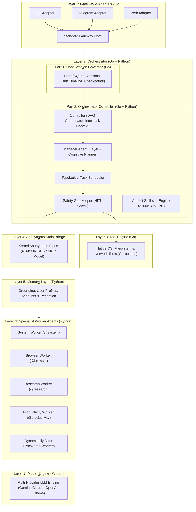

# System Architecture Specification

> **Concrete System Architecture & Layer Invariants**  
> **Backend Implementation:** Polyglot (Go Gateway/Orchestrator/Tools + Pure Async Python Cognitive Plane)

---

## 1. High-Level Architectural Topology

The system is organized into **7 decoupled layers** with clean boundaries, unidirectional dependencies, and strict process isolation:



---

## 2. Layer-by-Layer Concrete Responsibilities

### Layer 1: Client Adapters & Standard Gateway (Go)
- **Adapters (`src/gateway/adapters/`):** Translate client-specific protocols (CLI Bubbletea terminal, Telegram Bot API long-polling, REST/WebSocket) into normalized gateway contracts.
- **Immediate Logging & Heartbeat:** Emits immediate visual feedback upon submission and ticks a 2-second heartbeat during long-running remote operations so the user never stares at a static screen.
- **Gateway Core (`src/gateway/gateway.go`):** Ingestion normalizer and streaming event egress dispatcher. Guarantees backpressure and turn cancellation channels.

### Layer 2: Orchestrator (Go + Python)
Decoupled into two distinct subsystems:
- **Part 1: Host Session Governor (`src/orchestrator/host.go`):**
  - Exclusively owns SQLite database tables: `sessions`, `messages`, `checkpoints`, and `tool_audit_log`.
  - Reconstructs conversational history and sliding context windows.
  - Controls Human-In-The-Loop (HITL) turn suspension and persistent approval state.
- **Part 2: Orchestrator Controller (`src/orchestrator/controller.go`):**
  - **Manager Agent (`src/orchestrator/manager/` & `src/orchestrator/planner/`):** The **sole cognitive planning agent** of Layer 2. Possesses **zero leaf tools**. Evaluates user goals, inspects configured/discovered workers, and synthesizes an actionable `TaskPlan` Directed Acyclic Graph (DAG).
  - **Task Scheduler (`src/orchestrator/scheduler/`):** Topologically walks the DAG, executes ready tasks in parallel goroutines, passes prerequisite subtask outputs to dependent subtasks (`[task_X Result]`), and detects/auto-heals deadlocks.
  - **Safety Gatekeeper (`src/orchestrator/safety/`):** Validates capability risks against user execution mode (Interactive vs Autonomous) and safety policy rules (`config/safety_policies.json`).
  - **Artifact Spillover Engine (`src/orchestrator/spillover.go`):** Transparently offloads subtask outputs exceeding 100KB to `workspace/artifacts/<artifact_id>.txt`, substituting a pointer to prevent LLM context exhaustion.

### Layer 3: Tool Engine (Go)
- Native Go implementations of system operations: `sys_exec`, `sys_ps`, `fs_read`, `fs_write`, `fs_list`, `fs_ripgrep`, `git_status`, `git_commit`, etc.
- Concurrent execution via goroutines with sub-millisecond execution overhead.

### Layer 4: Anonymous Stdio Bridge
- Anonymous OS kernel pipes (`stdin`/`stdout`) transmitting Newline-Delimited JSON (NDJSON) frames.
- Sub-millisecond IPC latency with zero open network ports and automatic cascade process termination.

### Layer 5: Memory Layer (Python)
- Personal context grounding, account alias matching (e.g. personal vs work Gmail), dynamic tool prompt sync, and background reflection/fact extraction.

### Layer 6: Specialist Worker Agents (`src/agents/`) (Python)
- **Zero Monolithic Frameworks:** Pure async Python functions (`run_worker_agent()`) executing standard ReAct loops (max 10 iterations).
- **Contains ONLY Leaf Specialist Workers:**
  - `system`: Local OS commands, shell scripts, file manipulation, git operations.
  - `browser`: Interactive web automation, form filling, and screenshots via Playwright MCP.
  - `research`: Web search, fetching URLs, summarizing documentation, and fact extraction.
  - `productivity`: Personal communication, Gmail triage, and Google Calendar scheduling.
  - **Dynamic Workers:** Any new folder added to `src/agents/<name>` is automatically discovered by the Manager Agent.
- **Architectural Invariant:** The **Manager Agent is NOT in `src/agents/`**. The Manager Agent lives exclusively in Layer 2 (`src/orchestrator/manager/`).

### Layer 7: Model Engine (Python)
- Unified LLM interface supporting Google Gemini, Anthropic Claude, OpenAI, and local Ollama models with prompt caching and token accounting.

---

## 3. Manager Agent vs. Specialist Workers

| Dimension | Layer 2 Manager Agent (`src/orchestrator/manager/`) | Layer 6 Specialist Workers (`src/agents/`) |
| :--- | :--- | :--- |
| **Location** | `src/orchestrator/manager/manager.py` | `src/agents/<worker_name>/agent.py` |
| **Primary Role** | Cognitive reasoning, goal decomposition & DAG planning | Atomic task execution with leaf tools |
| **Leaf Tools** | **None** (No shell, no file writes, no browser actions) | Full leaf access (shell, files, browser, Gmail, calendar) |
| **Output Type** | Structured `TaskPlan` JSON (SubTasks + Dependencies) | Concrete task response, tool results, tokens |
| **Execution Loop**| Single-turn cognitive decomposition | Multi-turn ReAct loop (Reasoning + Acting, max 10 iters) |
| **Addressing** | Default auto-planner for unrouted turns (`"auto"`) | Direct addressing via `@system`, `@browser`, `@research` |

---

## 4. End-to-End Execution Lifecycle

```
1. User Input -> CLI / Telegram / Web Adapter
2. Adapter -> Immediate Log: "Turn initiated. Connecting to control plane..."
3. Gateway -> SubmitTurn -> Layer 2 Host
4. Host -> SQLite Session Verification: "Session verified. Handing turn to Controller..."
5. Controller -> Manager Agent: "Decomposing user request into actionable TaskPlan DAG..."
   - (Heartbeat ticker pulses if remote LLM call > 2s)
6. Manager Agent -> Emits TaskPlan DAG JSON (SubTasks, Workers, Dependencies)
7. Controller -> Scheduler: Topologically walks executable tasks
8. Scheduler -> Checks prerequisite inputs: prepends "[task_X Result]" into task prompt
9. Gatekeeper -> Evaluates tool/worker risk profile (LOW -> Execute; HIGH -> Request HITL via Host)
10. Worker Agent -> Executes atomic subtask, streams tokens/thoughts back to Gateway
11. Spillover Engine -> Intercepts outputs >100KB -> writes to disk artifact
12. Scheduler -> Marks task completed -> unlocks downstream tasks -> repeats until DAG complete
13. Controller -> Emits EventTurnComplete with model & token telemetry
14. Host -> Persists final turn response into SQLite messages table
15. Gateway -> Finalizes streaming egress to client adapter
```

---

## 5. Directory Structure

```
├── cmd/
│   └── assistant/          # Main application entry point (Go)
├── config/
│   ├── agents.json         # User toggles (enabled, model, routing rules)
│   └── safety_policies.json# Tool risk classifications and HITL thresholds
├── src/
│   ├── gateway/            # Layer 1: Adapters (CLI, etc.) and Gateway Core (Go)
│   ├── orchestrator/       # Layer 2: Orchestrator Subsystems
│   │   ├── host.go         # Part 1: Host Session Governor (SQLite, HITL)
│   │   ├── controller.go   # Part 2: Orchestrator Controller (DAG, workers)
│   │   ├── manager/        # Solitary Layer 2 Manager Agent (Python DAG planner)
│   │   ├── planner/        # Go Manager Agent bridge & worker discovery
│   │   ├── scheduler/      # Topological DAG Task Scheduler & dependency engine
│   │   ├── safety/         # Safety Gatekeeper & risk evaluation
│   │   ├── session/        # SQLite database store & DDL migrations
│   │   └── spillover.go    # Artifact spillover (>100KB to disk)
│   ├── tools/              # Layer 3: Native Go tool implementations
│   ├── bridge/             # Layer 4: Anonymous Stdio NDJSON pipe bridge
│   ├── memory/             # Layer 5: Python memory & user context grounding
│   ├── agents/             # Layer 6: Specialist Worker Agents ONLY
│   │   ├── system/         # Local OS & shell worker
│   │   ├── browser/        # Playwright web automation worker
│   │   ├── research/       # Web search & documentation worker
│   │   ├── productivity/   # Email & calendar worker
│   │   └── factory.py      # Specialist worker instantiator
│   └── models/             # Layer 7: LLM provider clients & token streaming
└── workspace/              # Local storage for session database & artifacts
    ├── data/               # sessions.db (SQLite)
    └── artifacts/          # Large payload spillover files
```
