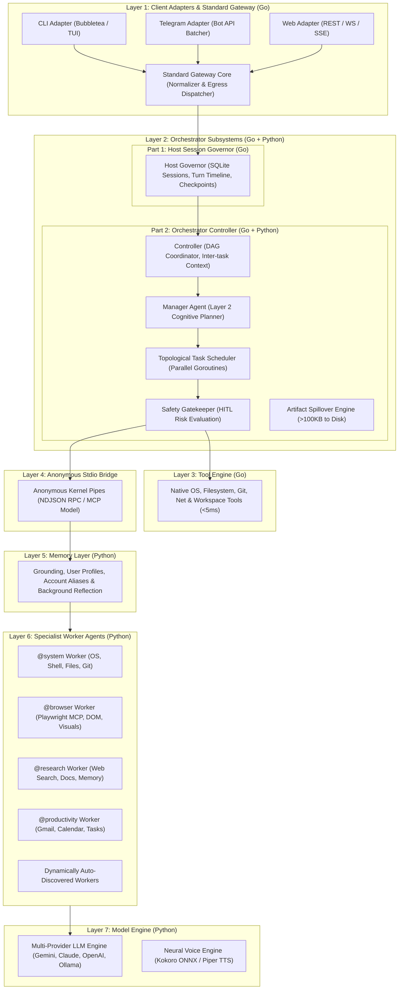

# 🤖 AI Personal Assistant (Polyglot Backend)

> **High-Performance, Secure, Local-First Personal Assistant with Polyglot Multi-Agent Architecture**  
> *Go Control Plane & Tool Engine + Pure Async Python Cognitive Plane*

[](https://golang.org)
[](https://python.org)
[](#-system-architecture)
[](#-license)
[](#)

---

## 🌟 Executive Overview

The **AI Personal Assistant Backend** is a modular, high-throughput, and secure personal assistant engine designed to manage your digital environment, automate browser workflows, synthesize complex research, and handle communications—all with zero external telemetry and strict local data governance.

### Why Polyglot?

Traditional AI agent stacks built entirely on heavy, monolithic Python frameworks (e.g., LangChain, LangGraph) suffer from severe limitations: **GIL execution bottlenecks**, **slow OS and file I/O operations**, **token bloat from shared contexts**, and **insecure tool execution paths**.

This project resolves these architectural bottlenecks by splitting responsibilities cleanly across two runtimes:

1. **Go Control Plane (Layers 1–4):** Handles client ingress/egress, high-concurrency WebSocket/CLI streaming, SQLite session management, Human-In-The-Loop (HITL) checkpoints, sub-millisecond native OS/filesystem/network tool execution, and DAG task scheduling.
2. **Python Cognitive Plane (Layers 5–7):** Houses the solitary Layer 2 Manager Agent (DAG decomposition), semantic memory injection (FAISS vector search), independent Specialist Worker Agents (pure async ReAct loops with zero monolithic framework dependencies), and multi-provider model routing.
3. **Anonymous Stdio Bridge:** Inter-process communication operates strictly via anonymous kernel pipes (`stdin`/`stdout`) using Newline-Delimited JSON (NDJSON) frames. No open network ports, zero SSL cert overhead, and guaranteed cascade process cleanup on exit.

---

## 🏗️ System Architecture

The backend is strictly divided into **7 decoupled layers** with unidirectional dependencies, explicit data contracts, and strong boundary isolation.



---

## 🔬 Layer-by-Layer Concrete Responsibilities

### [Layer 1: Client Adapters & Standard Gateway (Go)](file:///home/prit/Project_Linux/AI-Personal-Assistant-Backend/src/gateway)
- **Adapters (`src/gateway/adapters/`):** Translate transport-specific protocols into normalized gateway contracts:
  - **CLI Adapter (`cli/`):** High-responsiveness interactive terminal built on Bubbletea, supporting ANSI styling and raw keypresses.
  - **Telegram Adapter (`telegram/`):** Long-polling bot adapter with 500ms message editing rate-limit batchers.
  - **Web Adapter (`web/`):** REST endpoints, WebSockets, and Server-Sent Events (SSE).
- **Standard Gateway Core (`gateway.go`):** Ingestion normalizer into `InboundMessage` structs, streaming egress dispatcher, backpressure regulation, immediate user feedback logging, and 2-second heartbeat tickers for long-running remote LLM operations.

### [Layer 2: Orchestrator Subsystems (Go + Python)](file:///home/prit/Project_Linux/AI-Personal-Assistant-Backend/src/orchestrator)
Decoupled into two distinct subsystems:
- **Part 1: Host Session Governor (`host.go`):** Exclusively manages persistent SQLite tables (`sessions`, `messages`, `checkpoints`, `tool_audit_log`). Reconstructs conversation history, enforces sliding context windows, and manages Human-In-The-Loop (HITL) turn pause and resume states.
- **Part 2: Orchestrator Controller (`controller.go`):**
  - **Manager Agent (`src/orchestrator/manager/`):** The **sole cognitive planning agent** of Layer 2. Possesses **zero leaf tools** (cannot run shell commands or write files). Evaluates user goals, inspects configured/discovered workers, and synthesizes an actionable Directed Acyclic Graph (DAG) `TaskPlan`.
  - **Topological Task Scheduler (`scheduler/`):** Traverses the DAG, executes independent tasks concurrently via Goroutines, injects prerequisite subtask outputs forward (`[task_X Result]`), and auto-heals dependency deadlocks.
  - **Safety Gatekeeper (`safety/`):** Validates capability risks against user execution mode (Interactive vs Autonomous) and safety policy rules (`config/safety_policies.json`).
  - **Artifact Spillover Engine (`spillover.go`):** Transparently offloads subtask outputs exceeding 100KB to `workspace/artifacts/<artifact_id>.txt`, substituting lightweight pointer references to prevent LLM context exhaustion.

### [Layer 3: Tool Engine (Go)](file:///home/prit/Project_Linux/AI-Personal-Assistant-Backend/src/tools)
- High-speed, native Go implementations executing with sub-millisecond overhead:
  - **System:** `sys_exec`, `sys_ps`, `sys_kill`.
  - **Filesystem:** `fs_read`, `fs_write`, `fs_delete`, `fs_list`, `fs_ripgrep`.
  - **Git Operations:** `git_status`, `git_diff`, `git_commit`.
  - **Networking:** `net_fetch`, `net_search`.
  - **Workspace & Google APIs:** Fernet-encrypted token handling, `gmail_list`, `gmail_read`, `gmail_send_draft`, `calendar_list`.

### [Layer 4: Anonymous Stdio Bridge](file:///home/prit/Project_Linux/AI-Personal-Assistant-Backend/src/bridge)
- High-efficiency inter-process communication using OS anonymous pipes (`stdin`/`stdout`).
- Newline-Delimited JSON (NDJSON) framing based on MCP/LSP design principles.
- Sub-millisecond IPC latency with zero open network ports and automatic cascade process termination.

### [Layer 5: Memory Layer (Python)](file:///home/prit/Project_Linux/AI-Personal-Assistant-Backend/src/memory)
- User preference profiling (`Memory/user_info.json`).
- Account alias resolution (e.g. distinguishing personal vs work/university Gmail accounts).
- Active tool prompt synchronization and context budget enforcement.
- Semantic vector storage and fast-path recall via FAISS (`all-MiniLM-L6-v2`).
- Asynchronous post-turn reflection and passive fact learning.

### [Layer 6: Specialist Worker Agents (Python)](file:///home/prit/Project_Linux/AI-Personal-Assistant-Backend/src/agents)
- Pure async Python functions executing standardized ReAct loops (Reasoning + Action, bounded to max 10 iterations).
- **Zero Monolithic Frameworks:** Completely free of LangChain/LangGraph runtime dependencies.
- **Strict Specialization (Contains ONLY Leaf Workers):**
  - `@system`: Local Linux OS operations, shell scripts, file manipulation, and git version control.
  - `@browser`: Interactive web automation via Playwright MCP, CDP session attachment, dynamic DOM map navigation, form filling, and screenshots.
  - `@research`: Web queries, documentation fetching, multi-source fact-checking, and memory retrieval.
  - `@productivity`: Personal communications, Gmail search/reading/drafting, Google Calendar scheduling, and task management.
  - **Dynamic Worker Auto-Discovery:** Any new worker folder added under `src/agents/<name>` is automatically discovered and registered by `factory.py` and made available to the Manager Agent.

### [Layer 7: Model Engine (Python)](file:///home/prit/Project_Linux/AI-Personal-Assistant-Backend/src/models)
- Unified multi-provider LLM interface supporting Google Gemini, Anthropic Claude, OpenAI, and local Ollama models.
- **Gemini KV-Cache Prefix Pinning:** Canonical prompt ordering preserves prompt prefix cache hits, reducing token costs by 75–90% and accelerating TTFT by up to 10x.
- **Neural Voice Synthesis:** Integrated Kokoro ONNX and Piper TTS engines supporting English and Hindi voice generation with zero cloud latency.

---

## ⚡ Architectural Invariants

| Dimension | Layer 2 Manager Agent (`src/orchestrator/manager/`) | Layer 6 Specialist Workers (`src/agents/`) |
| :--- | :--- | :--- |
| **Location** | `src/orchestrator/manager/manager.py` | `src/agents/<worker_name>/agent.py` |
| **Primary Role** | Cognitive planning, goal decomposition & DAG generation | Atomic task execution using assigned leaf tools |
| **Leaf Tools** | **None** (No shell execution, no file writes, no browser actions) | Full leaf access (shell, files, browser, Gmail, calendar) |
| **Output Type** | Structured `TaskPlan` JSON (SubTasks + Dependencies) | Task response text, tool calls, token usage metadata |
| **Execution Loop** | Single-turn cognitive decomposition | Multi-turn async ReAct loop (max 10 iterations) |
| **Addressing** | Default auto-planner for unrouted turns (`"auto"`) | Direct addressing via `@system`, `@browser`, `@research`, `@productivity` |

---

## 🚀 Key Features

- **🎯 Autonomous DAG Decomposition:** Converts complex, multi-step natural language instructions into an executable task graph with explicit dependency tracking and parallel branch execution.
- **🔒 Zero-Trust Security Gatekeeper:** Every tool execution is evaluated against strict safety policies (`config/safety_policies.json`). Destructive operations (`fs_delete`, `sys_exec`, `git_commit`) automatically trigger Human-In-The-Loop approval checkpoints.
- **⚡ Sub-Millisecond Native Tools:** Filesystem searches (`fs_ripgrep`), shell commands, and git operations execute in compiled Go with direct OS syscalls, eliminating Python subprocess overhead.
- **🌐 Browser Automation (Playwright MCP):** Connects to live Chrome sessions via CDP (`http://localhost:9222`) or headless instances, navigates dynamic web apps, clicks interactive elements, and takes screenshots.
- **📧 Full Workspace & Communications Hub:** Search Gmail via sender/subject/date metadata, read email threads, generate drafts, schedule Google Calendar events, and synchronize Google Tasks.
- **🧠 Continuous Memory & Reflection:** Automatically extracts user preferences and facts across conversation turns, persisting them to structured profiles and local FAISS vector embeddings.
- **💾 Artifact Spillover Protection:** Payloads over 100KB are automatically written to disk (`workspace/artifacts/`), ensuring the LLM context window is never choked by massive tool responses.
- **🖥️ Developer Module Workbench:** Web-based developer dashboard with zero external dependencies (`go run ./cmd/bench-ui`), featuring live Server-Sent Events (SSE) streaming, interactive HITL testing, runtime profiling, and flight recording.

---

## 📂 Directory Structure

```text
AI-Personal-Assistant-Backend/
├── ARCHITECTURE.md             # Detailed System Architecture Specification
├── README.md                   # Project documentation & reference
├── go.mod                      # Go module definitions (v1.23+)
├── go.sum                      # Go dependency checksums
├── pytest.ini                  # Python test suite configuration
├── cmd/
│   ├── assistant/              # Main application CLI entry point (Go)
│   ├── bench-ui/               # Visual developer module workbench server (Go)
│   └── bench/tools/            # Native tool performance benchmarking CLI
├── config/
│   ├── .env.example            # Template for environment variables and secrets
│   ├── .env                    # Active environment configuration
│   ├── agents.json             # Agent toggles, models, temperatures, and concurrency
│   ├── safety_policies.json    # Tool risk classifications and HITL thresholds
│   ├── system.json             # System-level parameters (user identity, timezone, limits)
│   ├── speech.json             # Voice synthesizer configuration (Kokoro / Piper)
│   └── prompts/                # Master system prompts for Manager and Workers
├── src/
│   ├── gateway/                # Layer 1: Client Adapters & Gateway Core (Go)
│   │   ├── adapters/           # CLI (Bubbletea), Telegram, Web adapters
│   │   ├── contracts.go        # Unified Inbound/Outbound streaming interfaces
│   │   └── gateway.go          # Gateway Core normalizer and event dispatcher
│   ├── orchestrator/           # Layer 2: Orchestrator Subsystems
│   │   ├── host.go             # Part 1: Host Session Governor (SQLite, HITL)
│   │   ├── controller.go       # Part 2: Controller & worker coordinator
│   │   ├── manager/            # Solitary Layer 2 Manager Agent (Python DAG planner)
│   │   ├── planner/            # Go Manager Agent bridge & worker discovery
│   │   ├── scheduler/          # Topological DAG task scheduler & dependency runner
│   │   ├── safety/             # Safety Gatekeeper & risk policy evaluator
│   │   ├── session/            # SQLite store implementation & DDL migrations
│   │   └── spillover.go        # Artifact spillover engine (>100KB to disk)
│   ├── tools/                  # Layer 3: Native Go tool implementations
│   │   ├── dispatcher/         # Tool registry dispatcher
│   │   ├── tools/              # Native tool implementations (sys, fs, git, net, workspace)
│   │   ├── registry.go         # Global tool catalog and schema generator
│   │   └── spillover.go        # Tool-level disk offloading
│   ├── bridge/                 # Layer 4: Anonymous Stdio NDJSON IPC Bridge
│   │   ├── protocol/           # Message types, codec, and serialization contracts
│   │   ├── supervisor/         # Go-side process manager and pipe supervisor
│   │   └── daemon/             # Python-side async pipe reader and event emitter
│   ├── memory/                 # Layer 5: Memory Layer (Python)
│   │   ├── grounding/          # User context and account alias injector
│   │   ├── profiles/           # Structured user preference profiles
│   │   └── storage/            # FAISS vector store & semantic search
│   ├── agents/                 # Layer 6: Specialist Worker Agents ONLY (Python)
│   │   ├── engine/             # Lightweight async ReAct execution engine
│   │   ├── system/             # @system worker (OS, shell, files, git)
│   │   ├── browser/            # @browser worker (Playwright MCP)
│   │   ├── research/           # @research worker (Web search, docs, synthesis)
│   │   ├── productivity/       # @productivity worker (Gmail, Calendar, Tasks)
│   │   └── factory.py          # Dynamic worker registry & instantiator
│   └── models/                 # Layer 7: Model Engine (Python)
│       ├── providers/          # Multi-provider clients (Google, OpenAI, Claude, Ollama)
│       ├── cache/              # Gemini KV-cache prefix optimization manager
│       └── audio/              # Kokoro ONNX / Piper TTS neural voice synthesizer
├── test/                       # Comprehensive test suites
│   ├── gateway/                # Go Layer 1 Gateway unit and simulation tests
│   ├── orchestrator/           # Go Layer 2 Orchestrator tests
│   ├── tools/                  # Go Layer 3 Tool Engine tests
│   ├── agents/                 # Python Layer 6 Worker Agent tests (pytest)
│   └── bridge/                 # Layer 4 IPC Bridge integration tests
├── workbench/                  # Visual developer testbench web application
└── workspace/                  # Local runtime data (Git-ignored)
    ├── data/                   # SQLite database (sessions.db)
    └── artifacts/              # Large payload spillover files
```

---

## 🛠️ Getting Started

### Prerequisites

- **Go:** `1.23` or newer
- **Python:** `3.10` or newer (virtual environment recommended)
- **SQLite3:** Embedded via modern Go driver (`modernc.org/sqlite`, zero CGO required)
- **Git:** Installed on system path
- **Node.js & Playwright (Optional):** Required for `@browser` web automation

---

### 1. Installation

Clone the repository and set up both Go and Python environments:

```bash
# 1. Clone the repository
git clone https://github.com/yourusername/AI-Personal-Assistant-Backend.git
cd AI-Personal-Assistant-Backend

# 2. Install Go dependencies
go mod download

# 3. Set up Python virtual environment
python3 -m venv .venv
source .venv/bin/activate

# 4. Install Python dependencies
pip install -r requirements.txt

# (Optional) Install Playwright browser binaries for web automation
playwright install chromium
```

---

### 2. Configuration

Create your environment file by copying the template:

```bash
cp config/.env.example config/.env
```

Edit [config/.env](file:///home/prit/Project_Linux/AI-Personal-Assistant-Backend/config/.env) with your preferred model provider keys and settings:

```ini
# Primary Model Configuration
DEFAULT_MODEL=google:gemini-3.5-flash-lite
GEMINI_API_KEY=AIzaSy...

# Optional Secondary Providers
OPENAI_API_KEY=sk-...
ANTHROPIC_API_KEY=sk-ant-...

# Local Offline Execution (Optional)
OLLAMA_HOST=http://localhost:11434
OLLAMA_MODEL=llama3.2

# System Authorization Password for High-Risk HITL Actions
SYSTEM_PASSWORD=your_secure_password_here

# User Timezone
USER_TIMEZONE=Asia/Kolkata
```

---

### 3. Running the Assistant

#### A. Interactive CLI REPL Mode (Default)
Launch the full interactive terminal interface with real-time token streaming and status updates:

```bash
go run ./cmd/assistant
```

#### B. Single-Prompt Execution Mode
Run a single command non-interactively and exit upon completion:

```bash
go run ./cmd/assistant --prompt "Summarize the latest 3 git commits in this repository"
```

#### C. Plan-Only Mode
Inspect the Layer 2 Manager Agent's cognitive decomposition without executing worker tools:

```bash
go run ./cmd/assistant --plan-only --prompt "Search for recent papers on LLM caching and email a summary to me"
```

#### D. Visual Developer Workbench
Launch the embedded web-based testbench and flight recorder:

```bash
go run ./cmd/bench-ui
```
Open your browser to [http://localhost:8080](http://localhost:8080) to inspect real-time module traces, test inputs, and profile memory allocations.

---

## 🔒 Security Policies & Human-in-the-Loop (HITL)

Safety is enforced at the architecture level via the **Safety Gatekeeper** (`src/orchestrator/safety/`), governed by [config/safety_policies.json](file:///home/prit/Project_Linux/AI-Personal-Assistant-Backend/config/safety_policies.json):

```
Tool Invocation ──► Safety Gatekeeper ──┬──► [LOW Risk] ──────► Execute Instantly
                                       ├──► [MEDIUM Risk] ───► Verify Capabilities & Execute
                                       └──► [HIGH Risk] ─────► Request HITL Approval ──► (Pause Turn)
```

### Risk Classifications

- **🟢 LOW (Instant Execution):** Read-only operations that do not modify state.
  - `fs_read`, `fs_list`, `fs_ripgrep`, `git_status`, `git_diff`, `net_fetch`, `net_search`, `gmail_list`, `calendar_list`.
- **🟡 MEDIUM (Monitored Execution):** Non-destructive writes or staged actions.
  - `fs_write`, `gmail_send_draft`, `memory_store_fact`, `memory_update_profile`.
- **🔴 HIGH (HITL Approval Required):** Destructive actions, system-level execution, or state deletions.
  - `sys_exec`, `sys_kill`, `fs_delete`, `git_commit`, `git_push`, `memory_delete`.

When a tool triggers **HIGH** risk:
1. The Orchestrator halts subtask execution and saves a checkpoint in SQLite.
2. An interactive approval prompt is emitted to the user's client (CLI modal or Telegram callback).
3. The turn resumes immediately upon user confirmation or aborts cleanly if denied.

---

## ⚡ Performance & Token Optimization

1. **Deterministic Prompt Cache Pinning:** System instructions and tool definitions are canonically ordered to maximize Google Gemini's KV-cache hits, cutting prompt processing costs by up to 90%.
2. **Artifact Spillover Engine:** Outputs exceeding 100KB are automatically written to `workspace/artifacts/<id>.txt`. The agent receives a concise pointer and summary, preventing LLM context window crashes.
3. **Sub-Millisecond Native Tools:** Go native tools bypass the Python runtime entirely, executing filesystem, process, and network requests in $<5\text{ms}$.
4. **Anonymous Stdio Bridge:** Inter-process communication avoids HTTP overhead, port conflicts, and socket serialization penalties.

---

## 🧪 Testing & Verification

The project includes isolated test benches across all system layers:

```bash
# Run all Go unit and integration tests (Gateway, Orchestrator, Tools)
go test -v ./test/...

# Run Python Worker Agent test suite
pytest test/agents/ -v

# Run Native Tool benchmarks
go run ./cmd/bench/tools
```

---

## 🗺️ Roadmap

- [x] Polyglot 7-Layer Architecture (Go Control Plane + Python Cognitive Plane)
- [x] Anonymous Stdio NDJSON IPC Bridge
- [x] Solitary Layer 2 Manager Agent with DAG TaskPlan synthesis
- [x] Topological DAG Task Scheduler with parallel Goroutine execution
- [x] Native Go Tool Engine (`sys`, `fs`, `git`, `net`, `workspace`)
- [x] Artifact Spillover Engine for payloads >100KB
- [x] Safety Gatekeeper with configurable HITL risk policies
- [x] Embedded Developer Module Workbench & Flight Recorder (`cmd/bench-ui`)
- [ ] Telegram Bot Adapter with long-polling batcher
- [ ] Web Browser Dashboard Adapter (REST / WebSocket / SSE)
- [ ] Local Quantized Offline Model Mode via Ollama (Full Air-Gapped Autonomy)
- [ ] Multi-Account Google Workspace Switcher & Dynamic Credential Vault

---

## 📄 License

This project is licensed under the MIT License — see the [LICENSE](LICENSE) file for details.
