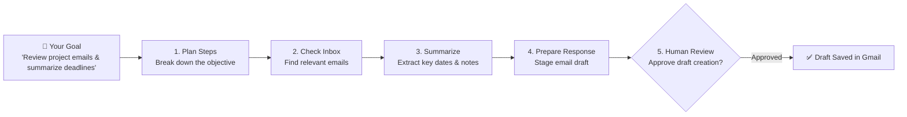
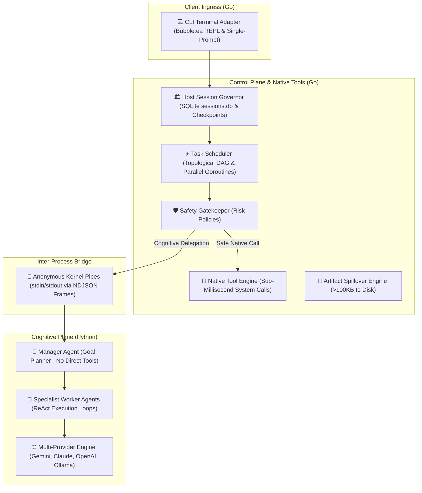

<h1 align="center">🤖 Me2: Intelligent Personal Assistant</h1>

<p align="center">
  <b>An autonomous desktop assistant that helps you organize files, manage communications, research the web, and accomplish everyday computer tasks—with complete user control and safety.</b>
</p>

<p align="center">
  <a href="#-quickstart"></a>
  <a href="#-documentation"></a>
  <a href="LICENSE"></a>
  
  
  
</p>

**Me2 is an intelligent personal assistant designed to run directly on your computer alongside you.** It transforms your everyday requests into completed actions—helping you manage your files, search the web, review calendar events, and triage emails through simple, natural conversation. Unlike standard chat assistants that remain confined to a web browser tab, Me2 collaborates directly with your desktop environment.

Use any AI model you prefer—Google Gemini, Anthropic Claude, OpenAI, or run 100% offline and private on your own hardware using Ollama. Switch configurations anytime with a single setting—no code changes, no vendor lock-in.

<table>
<tr><td><b>Direct workstation execution</b></td><td>Interacts directly with your local workspace—search files, inspect code, organize directories, monitor system activity, and run desktop utilities without switching windows.</td></tr>
<tr><td><b>Intelligent goal planning</b></td><td>Breaks complex, multi-step requests into clear, orderly action plans and coordinates specialized helpers to execute each step.</td></tr>
<tr><td><b>Safe and supervised (Zero-Trust)</b></td><td>Read-only actions run instantly. Destructive operations (deleting files, running system commands, sending emails) automatically pause for your explicit approval before taking action.</td></tr>
<tr><td><b>Email and calendar triage</b></td><td>Connects with your Google Workspace accounts to search messages, summarize upcoming events, and stage draft replies ready for your final review.</td></tr>
<tr><td><b>Web research and browsing</b></td><td>Conducts live web searches, retrieves online documentation, and navigates web pages using browser automation to gather information.</td></tr>
<tr><td><b>Private and model-agnostic</b></td><td>Supports leading cloud AI providers (Gemini, Claude, OpenAI) or fully offline, private local models via Ollama with zero external telemetry.</td></tr>
<tr><td><b>Developer workbench</b></td><td>Includes a built-in web testbench and flight recorder with live event streaming and interactive approval testing.</td></tr>
</table>

---

## 💡 Why Me2?

Modern work often suffers from **digital fragmentation**:

* **Trapped in Chat Windows**: Conventional AI assistants are isolated text generators. They cannot see your files, organize project folders, check your local calendar, or assist with everyday computer workflows.
* **Constant App Switching**: Finishing even a simple project requires constantly bouncing between email inboxes, file browsers, search tabs, calendar views, and text editors.
* **Uncertainty with Automation**: Traditional automated scripts and macros break easily when formats change, while unmonitored automation can take unintended actions without warning.
* **Loss of Oversight**: Entrusting automated software with your computer can feel concerning without clear visibility into what the assistant is doing and an easy way to approve or decline actions.

Me2 resolves this by combining proactive planning, specialized task helpers, and a transparent review process that keeps you in complete control.

---

## 🚀 How It Works

Instead of requiring you to micro-manage every subtask, you provide Me2 with a high-level goal in natural language:

1. **State Your Goal**: Tell Me2 what you want to achieve in plain, everyday language.
2. **Organize the Steps**: Me2 breaks down your objective into an organized, step-by-step checklist.
3. **Specialized Helpers**: Dedicated helper modules handle specific parts of the plan, such as finding a document, reading an inbox, or searching for recent information online.
4. **Human Review & Approval**: Safe lookup tasks happen instantly. Any action that creates, alters, or removes important data pauses for your direct sign-off before proceeding.



---

## 💻 Example Walkthrough

Here is an actual interactive terminal session showing how Me2 breaks down a request and requests your permission before creating a draft:

```text
user@workstation:~$ go run ./cmd/assistant

> Check unread emails from college, summarize pending tasks, and draft a reply

✦ [Me2 Orchestrator] Decomposing goal into 3-stage plan:
  ├── Task 1: [@productivity] Fetch unread Gmail threads from domain "college.edu"
  ├── Task 2: [@research]     Cross-reference assignment deadlines with course syllabus
  └── Task 3: [@productivity] Generate reply draft with submission confirmation

✓ Task 1 complete: Found 2 unread emails from Prof. Miller (Subject: Final Project Submissions)
✓ Task 2 complete: Extracted deadline: Friday, 11:59 PM. Verified zip attachment requirements.

════════════════════════════════════════════════════════════════════════════════
🛡️ [HUMAN-IN-THE-LOOP APPROVAL REQUIRED]
Worker '@productivity' requested action: gmail_send_draft
Target Account: college | Recipient: miller@college.edu
Subject: Re: Final Project Submissions
Staged Action: Create a new draft in Gmail
Approve this draft creation? [Y/n]: Y
════════════════════════════════════════════════════════════════════════════════

✓ Draft created successfully in Gmail.

Summary:
• Retrieved 2 emails from Prof. Miller regarding your project submission.
• Extracted submission deadline: Friday, 11:59 PM.
• Staged a confirmation draft in Gmail ready for your final review.

✨ Turn complete in 2.84s (Model: gemini-3.5-flash-lite).
```

---

## ⚡ Quickstart

### Prerequisites

* **Go**: `1.23` or higher ([Download Go](https://golang.org/dl/))
* **Python**: `3.10` or higher ([Download Python](https://www.python.org/downloads/))
* **Git**: Installed on system path
* **AI Model Credentials**: Google Gemini (recommended: `gemini-3.5-flash-lite`), OpenAI, Anthropic, or local [Ollama](https://ollama.ai)

---

### 1. Installation

```bash
# Clone the repository
git clone https://github.com/yourusername/Me2.git
cd Me2

# Download Go module dependencies
go mod download

# Set up Python virtual environment
python3 -m venv .venv
source .venv/bin/activate  # On Windows: .venv\Scripts\activate

# Install Python dependencies
pip install -r requirements.txt

# (Optional) Install Playwright browser binaries for web automation
playwright install chromium
```

---

### 2. Configure Credentials

Copy the template environment file:

```bash
cp config/.env.example config/.env
```

Open [config/.env](config/.env) and set your preferred model configuration:

```ini
# Default Model Configuration
DEFAULT_MODEL=google:gemini-3.5-flash-lite
GEMINI_API_KEY=your_gemini_api_key_here

# Optional: Secondary Providers
OPENAI_API_KEY=your_openai_key
ANTHROPIC_API_KEY=your_anthropic_key

# Optional: 100% Offline Local Model via Ollama
OLLAMA_HOST=http://localhost:11434
OLLAMA_MODEL=llama3.2

# Password required for authorizing high-risk tools (HITL)
SYSTEM_PASSWORD=your_secure_password
```

---

### 3. Run Me2

```bash
go run ./cmd/assistant                                                # Interactive terminal conversation
go run ./cmd/assistant --prompt "Summarize recent git changes"        # Single instruction execution
go run ./cmd/assistant --plan-only --prompt "Draft weekly report"     # Inspect task plan without executing
go run ./cmd/bench-ui                                                 # Web developer testbench (http://localhost:8080)
```

---

## 🧭 Interface & Modes Reference

Me2 offers multiple entry points depending on how you want to interact:

| Mode | Command | Best For | Behavior |
| :--- | :--- | :--- | :--- |
| **Interactive CLI** | `go run ./cmd/assistant` | Everyday work & conversations | Interactive multi-turn conversation with real-time streaming and status updates |
| **Single-Prompt** | `go run ./cmd/assistant --prompt "..."` | Quick scripts & automation | Executes a specific goal non-interactively and exits when finished |
| **Plan Preview** | `go run ./cmd/assistant --plan-only --prompt "..."` | Dry-runs & plan audits | Shows how the planner breaks down a request into subtasks without running tools |
| **Developer Workbench** | `go run ./cmd/bench-ui` | Development, testing & inspection | Web interface (`http://localhost:8080`) with live event streaming and flight recording |

---

## 🏗️ System Architecture

For developers and contributors, Me2 is engineered as a clean two-engine system that separates high-speed system operations from cognitive planning:



### Specialist Worker Agents

To maintain clean context windows and avoid agent confusion, worker agents have focused responsibilities:

| Agent | Scope | Assigned Capabilities |
| :--- | :--- | :--- |
| **`@manager`** | Planning | Evaluates goals and produces structured task plans. Operates with **zero leaf tools** to prevent accidental actions during planning. |
| **`@system`** | Workstation | Shell execution (`sys_exec`), process manager (`sys_ps`, `sys_kill`), file management & `ripgrep`, and git operations. |
| **`@browser`** | Web Automation | Playwright browser driver: page navigation, accessible text inspection, element interaction, and screenshots. |
| **`@research`** | Web Search | Live web search (`net_search`) and HTTP data retrieval (`net_fetch`). |
| **`@productivity`**| Workspace | Gmail inbox listing & reading, email draft staging, and Google Calendar event lookup. |

---

## 🛡️ Safety & Human-in-the-Loop (HITL)

Security and trust are enforced at the architectural level through the **Safety Gatekeeper** in Go ([src/orchestrator/safety/policy.go](src/orchestrator/safety/policy.go)), configured by [config/safety_policies.json](config/safety_policies.json).

```text
  Tool Invocation Request
            │
            ▼
┌─────────────────────────┐
│    Safety Gatekeeper    │
└───────────┬─────────────┘
            │
            ├─► 🟢 LOW Risk     ──────► Execute Instantly (<5ms)
            │                         (fs_read, fs_ripgrep, git_status, net_search, gmail_list)
            │
            ├─► 🟡 MEDIUM Risk  ──────► Verify Capabilities & Execute
            │                         (fs_write, gmail_send_draft, browser_click)
            │
            └─► 🔴 HIGH Risk    ──────► ⏸️ PAUSE Turn & Save Checkpoint in SQLite
                                      Display interactive approval prompt to user CLI
                                      (sys_exec, sys_kill, fs_delete, git_commit)
```

> 🛡️ **Zero-Trust Principle**: Destructive or externally visible operations (`sys_exec`, `fs_delete`, `git_commit`) will **never** execute automatically. Me2 pauses the turn, saves a checkpoint in SQLite, and prompts for your explicit approval (`[Y/n]`).

---

## 🔧 Available Tools

All registered tools in the Go tool dispatcher ([src/tools/dispatcher/dispatcher.go](src/tools/dispatcher/dispatcher.go)):

| Category | Tool | Description | Risk Level |
| :--- | :--- | :--- | :---: |
| **System** | `sys_exec` | Executes bash commands with working directory and timeout | 🔴 HIGH (HITL) |
| **System** | `sys_ps` | Lists active processes, CPU, memory, and PIDs | 🟢 LOW |
| **System** | `sys_kill` | Sends termination signals to a process by PID | 🔴 HIGH (HITL) |
| **Filesystem** | `fs_read` | Reads file contents with optional start/end line offsets | 🟢 LOW |
| **Filesystem** | `fs_write` | Writes text content to disk | 🟡 MEDIUM |
| **Filesystem** | `fs_delete` | Deletes files or directories | 🔴 HIGH (HITL) |
| **Filesystem** | `fs_list` | Lists files and directories at a given path | 🟢 LOW |
| **Filesystem** | `fs_ripgrep` | Fast regex and keyword search across file trees | 🟢 LOW |
| **Git** | `git_status` | Returns working tree status and branch info | 🟢 LOW |
| **Git** | `git_diff` | Returns staged or unstaged diffs | 🟢 LOW |
| **Git** | `git_commit` | Creates a git commit with a message | 🔴 HIGH (HITL) |
| **Network** | `net_search` | Queries web search engine for snippets and URLs | 🟢 LOW |
| **Network** | `net_fetch` | Performs HTTP requests with custom headers and methods | 🟢 LOW |
| **Workspace** | `gmail_list` | Queries messages in inbox/unread matching a query | 🟢 LOW |
| **Workspace** | `gmail_read` | Fetches headers and body of an email by message ID | 🟢 LOW |
| **Workspace** | `gmail_send_draft` | Creates a new draft message in Gmail | 🟡 MEDIUM |
| **Workspace** | `calendar_list` | Queries upcoming Google Calendar events | 🟢 LOW |
| **Browser** | `browser_navigate` | Navigates to a URL via Playwright / CDP | 🟢 LOW |
| **Browser** | `browser_read_content` | Reads accessible text and layout of active page | 🟢 LOW |
| **Browser** | `browser_click` | Clicks an interactive element by selector | 🟡 MEDIUM |
| **Browser** | `browser_type` | Types text into an interactive form input | 🟡 MEDIUM |
| **Browser** | `browser_screenshot` | Captures a screenshot of the active browser viewport | 🟢 LOW |

---

## 📚 Documentation

Comprehensive architectural specifications and development guides are organized within the project:

| Guide / Specification | Location | What's Covered |
| :--- | :--- | :--- |
| **System Architecture** | [ARCHITECTURE.md](ARCHITECTURE.md) | 7-layer design, IPC bridge, session governor, and subsystem contracts |
| **Adapter & Observer Guide** | [guide/adapters/OBSERVER_ADAPTER_GUIDE.md](guide/adapters/OBSERVER_ADAPTER_GUIDE.md) | Building custom client adapters (CLI, Web, Telegram), observer hooks, and live state snapshots |
| **Developer Guides Index** | [guide/README.md](guide/README.md) | Standard developer policies, contracts, and core engine invariants |
| **Safety Policies** | [config/safety_policies.json](config/safety_policies.json) | Configurable risk categories, tool execution permissions, and HITL rules |
| **Environment Configuration** | [config/.env.example](config/.env.example) | Full reference for AI providers, local models, and system credentials |
| **Safety Gatekeeper Engine** | [src/orchestrator/safety/policy.go](src/orchestrator/safety/policy.go) | Core Go policy evaluation and approval gatekeeper implementation |
| **Tool Dispatcher** | [src/tools/dispatcher/dispatcher.go](src/tools/dispatcher/dispatcher.go) | Central dispatch registry for all native Go tools and capabilities |

---

## 🖥️ Developer Workbench

Me2 includes a self-contained web testbench and event monitor built directly into the Go binary:

```bash
go run ./cmd/bench-ui
```

Open your browser to:
```text
http://localhost:8080
```

* **Live Event Stream**: Watch real-time tokens, planning steps, tool invocations, and completion events over Server-Sent Events (SSE).
* **Interactive Approval Testing**: Trigger high-risk tools and test approval modals in real time.
* **Flight Recording**: Every test run is saved to `workspace/workbench/history.jsonl` for replay and inspection.

---

## 🧪 Testing

Me2 includes comprehensive unit, integration, and benchmark suites:

```bash
# Run all Go unit and tool tests
go test -v ./test/tools/... ./test/gateway/...

# Run Python Worker Agent tests with pytest
.venv/bin/pytest test/agents/ -v

# Run Native Go tool performance benchmarks
go run ./cmd/bench/tools
```

---

## 🗺️ Roadmap

### ✅ Implemented & Verified
- [x] Dual-engine architecture (Go Control Plane + Python Cognitive Plane)
- [x] Secure anonymous pipe communication using NDJSON framing
- [x] Manager Agent goal decomposition with zero unauthorized leaf tools
- [x] Task scheduler with parallel task execution
- [x] Safety Gatekeeper with configurable risk policies (`config/safety_policies.json`)
- [x] Native tool engine (`sys`, `fs`, `git`, `net`, `workspace`)
- [x] Browser automation via Playwright
- [x] Artifact spillover handling for large payloads exceeding 100KB
- [x] SQLite session governance and tool audit logging
- [x] Embedded Developer Workbench and Flight Recorder (`cmd/bench-ui`)

### 🚧 In Progress / Planned
- [ ] Memory Layer (FAISS vector store, user profile grounding, background reflection)
- [ ] Local Neural Audio Engine (Kokoro ONNX & Piper TTS voice synthesis)
- [ ] Telegram Bot long-polling daemon integration
- [ ] Web Browser Client Interface (REST / WebSocket / SSE dashboard)
- [ ] Document RAG (PDF, DOCX, XLSX content extraction)

---

## 📄 License

This project is licensed under the [MIT License](LICENSE).
