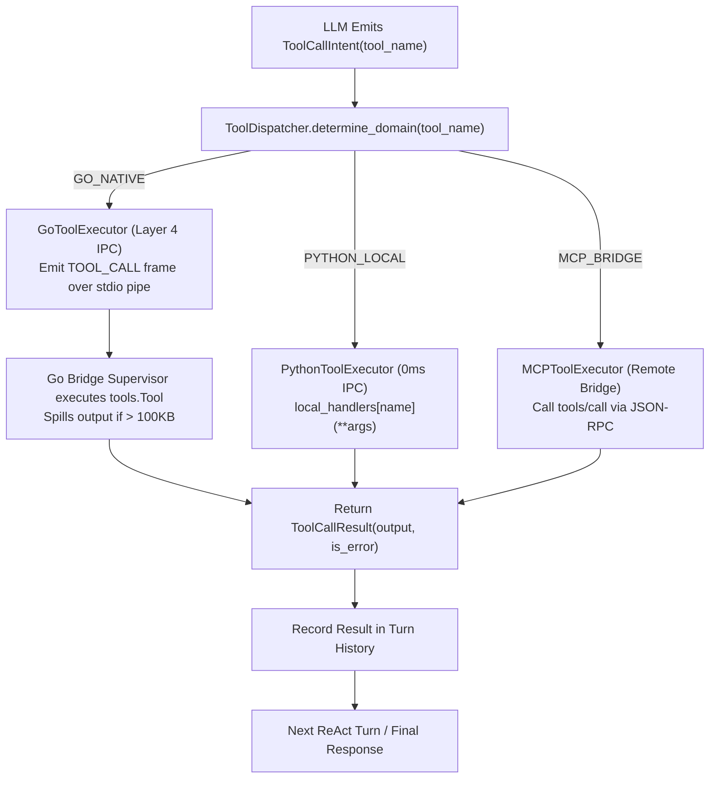

# Specialist Agent & Tool Development Guide

> **Document Version:** 3.0.0 (Polyglot ToolDispatcher & Explicit Tool Declaration Standard)  
> **Status:** Authoritative Standard Specification  
> **Target Scope:** Architecture, `BaseAgent` Implementation, Explicit Tool Declaration ("A tool exists to be used" — Removal of Auto-Discovery), Modular Polyglot `ToolDispatcher` (Python Local, Go Native IPC, MCP Bridge), Dynamic Prompt Injection, Safety, and Testing  
> **Primary Components:** [`src/agents/Base/base.py`](file:///home/prit/Project_Linux/AI-Personal-Assistant-Backend/src/agents/Base/base.py), [`src/agents/engine/dispatcher/`](file:///home/prit/Project_Linux/AI-Personal-Assistant-Backend/src/agents/engine/dispatcher/), [`src/agents/<name>/AgentTools/`](file:///home/prit/Project_Linux/AI-Personal-Assistant-Backend/src/agents/research/AgentTools/)

---

## 1. Executive Summary & Architectural Philosophy

In this backend architecture, **Layer 6 Specialist Worker Agents** are autonomous, bounded cognitive workers (`system`, `browser`, `research`, `productivity`, `memory`, `summarizer`, and custom domain agents). Each worker acts as a bounded expert with its own prompt persona, explicit tool capabilities, and ReAct execution loop.

### A. The Brains vs. Hands Principle
* **Agents are Brains**: They are active cognitive personas with an LLM prompt, context window, and multi-turn reasoning loop. They decide *what* to do.
* **Tools are Hands**: They are deterministic execution endpoints (e.g. query SQLite, calculate math, run bash, click a web element, or query an external MCP service). They do **not** run an LLM.

### B. Why `BaseAgent` & `ToolDispatcher`?
Previously, worker agents had to manually duplicate boilerplate:
* Manually building `AgentContext` and packing prompts, tools, and history.
* Manually managing domain execution (Python in-process vs. Go IPC vs. MCP JSON-RPC).
* Handling uncaught exceptions and creating fallback `AgentTurnResult` objects.
* Manually binding local tool execution handlers.

With **`BaseAgent`**, creating an agent is purely declarative. The base class coordinates modular subsystems in `src/agents/Base/` and delegates tool routing directly to the pluggable **`ToolDispatcher`**:

```
                           ┌────────────────────────────┐
                           │         BaseAgent          │
                           └──────────────┬─────────────┘
                                          │ coordinates
      ┌───────────────────┬───────────────┼───────────────┬───────────────────┐
      ▼                   ▼               ▼               ▼                   ▼
┌───────────────┐ ┌───────────────┐ ┌───────────┐ ┌───────────────┐ ┌───────────────────┐
│ ToolRegistry  │ │ PromptManager │ │  Context  │ │  AgentHooks   │ │  AgentValidator   │
│ (Catalog/Risk)│ │(Prompt/Format)│ │ (Context) │ │(Before/After) │ │(Diagnostics/Check)│
└───────┬───────┘ └───────────────┘ └───────────┘ └───────────────┘ └───────────────────┘
        │
        ▼ delegates execution
┌─────────────────────────────────────────────────────────────────────────────┐
│                           ToolDispatcher                                    │
│  ┌──────────────────────┬──────────────────────┬─────────────────────────┐  │
│  │  PythonToolExecutor  │    GoToolExecutor    │     MCPToolExecutor     │  │
│  │ (In-process, 0ms IPC)│ (Layer 4 IPC stdio)  │   (MCP JSON-RPC bridge) │  │
│  └──────────────────────┴──────────────────────┴─────────────────────────┘  │
└─────────────────────────────────────────────────────────────────────────────┘
```

---

## 2. Standard Directory Structure Blueprint

Specialist agents live in `src/agents/<agent_name>/` using lowercase `snake_case`. Every agent directory adheres to a standardized 4-module layout:

```text
src/agents/<agent_name>/
├── agent.py                 # [MANDATORY] Agent class subclassing BaseAgent
├── prompt.md                # [MANDATORY] Raw persona directives and rules (Markdown)
├── prompts.py               # [OPTIONAL] System prompt loader helper with dynamic/disk fallback
├── <agent_name>_config.json # [MANDATORY] Declarative JSON manifest (model, aliases, capabilities)
└── AgentTools/              # [RECOMMENDED for Multi-Tool Workers]
    ├── __init__.py          # Re-exports tool definitions and local handler getters
    ├── tools.py             # In-process Python tools + unified schema catalog
    └── tools.go             # Go-native tools + GetAllTools() slice exporter
```

> **Note on Lightweight Workers**: If an agent only uses existing Go-native tools or has simple declarative schemas without custom Python callables, a single `tools.py` file can be placed directly at `src/agents/<agent_name>/tools.py`. For workers requiring in-process Python execution or worker-scoped Go tools, use the `AgentTools/` bundle.

---

## 3. Explicit Tool Declaration & ToolDispatcher (Removal of Auto-Discovery)

> [!IMPORTANT]
> **CORE ARCHITECTURAL RULE: A TOOL EXISTS TO BE USED**  
> **Tool auto-discovery has been permanently removed.** In earlier versions, `BaseAgent` attempted reflection and directory scanning to discover tools in sibling packages. This introduced silent coupling, hidden dependencies, and unpredictable runtime behaviors.  
> In Version 3.0.0+, tools are **strictly declarative and explicitly declared**. An agent possesses only the tools explicitly assigned to it.

### Tool Resolution Hierarchy
When an agent is instantiated, its tools and local handlers are resolved via a deterministic, explicit priority chain:

1. **Explicit Constructor Argument** (`tools=[...]`, `local_handlers={...}`, `tool_dispatcher=...`) -> *Highest priority*
2. **Subclass Class-Level Attribute** (`tools = [...]`, `local_handlers = {...}`) -> *Second priority*
3. **Safe Empty Baseline** (`tools = []`, `local_handlers = {}`) -> *Default (zero phantom tools, zero crashes)*

```
┌──────────────────────────────────────────────┐
│  1. Constructor Parameter (Explicit)         │  ◄── Overrides everything
├──────────────────────────────────────────────┤
│  2. Class Attribute on Subclass              │  ◄── Declarative subclass definition
├──────────────────────────────────────────────┤
│  3. Explicit Empty Baseline ([])             │  ◄── Safe default (no magic reflection)
└──────────────────────────────────────────────┘
```

### Automatic `ToolDispatcher` Wiring
`BaseAgent` automatically instantiates and manages an internal [`ToolDispatcher`](file:///home/prit/Project_Linux/AI-Personal-Assistant-Backend/src/agents/engine/dispatcher/dispatcher.py):
* All tools passed via `tools` are registered into `self.registry` and `self.tool_dispatcher`.
* In-process Python callables passed via `local_handlers` are registered into `self.tool_dispatcher`.
* Modifying tools via `agent.register_tool()`, `agent.register_tools()`, `agent.unregister_tool()`, or `agent.tools = [...]` automatically synchronizes both `ToolRegistry` and `ToolDispatcher`.
* The agent provides direct execution methods:
  - `await agent.execute_tool(tool_name, arguments, ...)`: Directly executes a single tool intent via `ToolDispatcher`.
  - `await agent.execute_turn_response(llm_response, ...)`: Parses all tool calls from an LLM turn output and executes them concurrently/sequentially via `ToolDispatcher`.

---

## 4. ToolDispatcher in Agent Creation: Patterns & Code Recipes

Every specialist worker agent requires tools to perform actions. When creating an agent, **`ToolDispatcher`** serves as the central router and execution engine. You can instantiate and wire agents using three primary patterns:

### Pattern 1: Lean Declarative Subclass (Implicit ToolDispatcher)
For standard agents using predefined tool lists, pass `tools` explicitly to `super().__init__()`. `BaseAgent` automatically instantiates an internal `ToolDispatcher` pre-bound to your tools and local handlers:

```python
# src/agents/browser/agent.py
from src.agents.Base import BaseAgent
from src.agents.browser.tools import BROWSER_TOOLS
from src.agents.contracts import AgentType
from src.models.base import BaseLLMClient

class BrowserAgent(BaseAgent):
    """Specialized worker for web browsing, Playwright automation, and scraping."""
    
    def __init__(self, model_client: BaseLLMClient) -> None:
        super().__init__(
            model_client=model_client,
            agent_type=AgentType.BROWSER,
            tools=BROWSER_TOOLS,
        )

# Direct tool execution is immediately available on the created instance:
# agent = BrowserAgent(model_client)
# result = await agent.execute_tool("browser_navigate", {"url": "https://example.com"})
```

---

### Pattern 2: Full-Featured Subclass with Custom `ToolDispatcher` Injection
For agents requiring custom handlers, MCP protocol bridges, IPC stdio pipes, or dynamic prompt enrichment (e.g. `ResearchAgent`), instantiate and configure a `ToolDispatcher` during agent initialization:

```python
# src/agents/research/agent.py
from __future__ import annotations

from typing import Any, Callable, Dict, List, Optional
from src.agents.Base import BaseAgent
from src.agents.contracts import (
    AgentContext,
    AgentType,
    MemoryEngineProtocol,
    PipeEmitterProtocol,
    PipeReaderProtocol,
    ToolCallResult,
    ToolDefinition,
)
from src.agents.engine.dispatcher import (
    MCPClientProtocol,
    ToolDispatcher,
    ToolTurnExecutionResult,
)
from src.agents.research.AgentTools import (
    enrich_prompt_with_tools,
    get_research_local_handlers,
    get_research_tool_definitions,
)
from src.agents.research.prompts import get_research_prompt
from src.models.base import BaseLLMClient


class ResearchAgent(BaseAgent):
    """Specialized worker for deep research, web searches, fact-checking, and memory notes."""

    def __init__(
        self,
        model_client: BaseLLMClient,
        custom_tools: Optional[List[ToolDefinition]] = None,
        custom_handlers: Optional[Dict[str, Callable]] = None,
        auto_enrich_prompt: bool = False,
        tool_dispatcher: Optional[ToolDispatcher] = None,
        pipe_emitter: Optional[PipeEmitterProtocol] = None,
        pipe_reader: Optional[PipeReaderProtocol] = None,
        memory_engine: Optional[MemoryEngineProtocol] = None,
        mcp_client: Optional[MCPClientProtocol] = None,
        **kwargs: Any,
    ) -> None:
        # 1. Explicitly resolve tools and local handlers
        tools = custom_tools if custom_tools is not None else get_research_tool_definitions()
        self.local_handlers: Dict[str, Callable] = dict(get_research_local_handlers())
        if custom_handlers:
            self.local_handlers.update(custom_handlers)

        # 2. Configure ToolDispatcher with polyglot capabilities
        self.tool_dispatcher: ToolDispatcher = tool_dispatcher or ToolDispatcher(
            tools=tools,
            pipe_emitter=pipe_emitter,
            pipe_reader=pipe_reader,
            memory_engine=memory_engine,
            mcp_client=mcp_client,
            local_handlers=self.local_handlers,
        )

        # 3. Dynamic prompt enrichment
        self._base_prompt = get_research_prompt()
        system_prompt = (
            enrich_prompt_with_tools(self._base_prompt, tools)
            if auto_enrich_prompt
            else self._base_prompt
        )

        super().__init__(
            model_client=model_client,
            agent_type=AgentType.RESEARCH,
            system_prompt=system_prompt,
            tools=tools,
            memory_engine=memory_engine,
            tool_dispatcher=self.tool_dispatcher,
            local_handlers=self.local_handlers,
            **kwargs,
        )

    def get_base_prompt(self) -> str:
        """Returns the unmodified base system prompt."""
        return self._base_prompt

    def get_enriched_prompt(self) -> str:
        """Returns the system prompt dynamically enriched with active tool usage guidance."""
        return enrich_prompt_with_tools(self._base_prompt, self.get_tools())
```

---

### Pattern 3: Factory Instantiation (`create_agent` & `create_all_agents`)
In runtime daemons and background tasks, agents are instantiated dynamically via the centralized factory in [`src/agents/factory.py`](file:///home/prit/Project_Linux/AI-Personal-Assistant-Backend/src/agents/factory.py). You can inject a pre-configured or shared `ToolDispatcher`:

```python
from src.agents.factory import create_agent, create_all_agents
from src.agents.contracts import AgentType
from src.agents.engine.dispatcher import ToolDispatcher
from src.models.factory import ModelFactory

# 1. Construct LLM client and optional shared ToolDispatcher
model_client = ModelFactory.get_client("google:gemini-3.5-flash")
custom_dispatcher = ToolDispatcher(
    pipe_emitter=pipe_emitter,
    pipe_reader=pipe_reader,
    mcp_client=remote_mcp_client,
)

# 2. Instantiate a single agent with injected ToolDispatcher
research_agent = create_agent(
    agent_type=AgentType.RESEARCH,
    model_client=model_client,
    tool_dispatcher=custom_dispatcher,
)

# 3. Instantiate all active agents registered in config/agents.json
all_agents = create_all_agents(
    model_client=model_client,
    tool_dispatcher=custom_dispatcher,
)
```

---

### Pattern 4: Direct Tool Execution via the Created Agent
Once an agent is created, it exposes three execution modes powered by its `ToolDispatcher`:

1. **Full Autonomous ReAct Turn** (LLM reasoning loop + multi-iteration tool calls):
   ```python
   result = await agent.execute_turn(
       session_id="session_001",
       turn_id="turn_001",
       prompt="Compare performance of Go vs Python for IPC",
   )
   print(result.final_response)
   ```

2. **Direct Tool Invocation** (Bypass LLM, invoke tool through optimal domain route):
   ```python
   # Calls in-process Python callable (0ms IPC)
   result = await agent.execute_tool("research_calculate", {"expression": "2 ** 16"})
   print(result.output)  # "65536"

   # Calls Go-native tool over Layer 4 IPC stdio pipe
   net_res = await agent.execute_tool("net_search", {"query": "Antigravity agents", "limit": 3})
   print(net_res.output)
   ```

3. **Turn Response Tool Execution** (Execute tool calls parsed from an LLM chunk or JSON payload):
   ```python
   # Execute a tool-call payload directly
   exec_result = await agent.execute_turn_response(llm_tool_calls_dict)
   for res in exec_result.results:
       print(f"Tool {res.call_id}: {res.output}")
   ```

---

## 5. Polyglot Tool Domains: Python vs. Go vs. MCP

`ToolDispatcher` classifies each tool into one of three execution domains:

| Requirement | **Python Local** (`tools.py`) | **Go Native** (`tools.go`) | **MCP Bridge** (Remote MCP) |
| :--- | :--- | :--- | :--- |
| **Execution Domain** | `execution_domain="python_local"` | `execution_domain="go_native"` | `execution_domain="mcp_bridge"` |
| **Execution Path** | In-process asynchronous callable inside Python daemon | Dispatched over Layer 4 IPC pipe to Go tool engine | JSON-RPC over stdio or SSE to MCP server |
| **Latency** | **0 ms** IPC overhead (direct Python memory/async) | Sub-millisecond OS exec with goroutine concurrency | Network / subprocess pipe latency |
| **Ideal For** | Data parsing, NLP, math, citation formatting, local RAG | Shell execution, heavy filesystem I/O, Git, Linux signals | External SaaS tools, Slack, GitHub, Database bridges |

---

### Step 1: Writing Python-Local Tools (`AgentTools/tools.py`)

Python-local tools are defined using the `@register_tool` decorator. Attach the decorator to synchronous or `async` callables:

```python
# src/agents/<worker>/AgentTools/tools.py
from typing import Any, Callable, Dict, List, Optional, Tuple
from src.agents.contracts import ToolDefinition

REGISTRY: Dict[str, Tuple[ToolDefinition, Optional[Callable]]] = {}

def register_tool(
    name: str,
    category: str,
    description: str,
    risk: str = "LOW",
    prompt_usage_tip: str = "",
    parameters: Optional[Dict[str, Any]] = None,
    execution_domain: str = "python_local",
    required_capability: str = "",
) -> Callable[[Optional[Callable]], Optional[Callable]]:
    def decorator(fn: Optional[Callable] = None) -> Optional[Callable]:
        tool_def = ToolDefinition(
            name=name,
            category=category,
            description=description,
            risk=risk,
            prompt_usage_tip=prompt_usage_tip,
            parameters=parameters or {"type": "object", "properties": {}},
            execution_domain=execution_domain,
            required_capability=required_capability,
        )
        REGISTRY[name] = (tool_def, fn)
        return fn
    return decorator


# --- Example In-Process Tool ---
@register_tool(
    name="research_calculate",
    category="research",
    description="Performs safe mathematical calculations for research data.",
    risk="LOW",
    prompt_usage_tip="Use for quick arithmetic, percentage deltas, or scientific calculation.",
    parameters={
        "type": "object",
        "properties": {
            "expression": {"type": "string", "description": "Mathematical formula to evaluate"}
        },
        "required": ["expression"]
    },
    execution_domain="python_local"
)
def research_calculate(expression: str) -> str:
    """Safe evaluation logic in-process."""
    return str(eval(expression, {"__builtins__": {}}, {}))


# --- Declaring Go-Native Tools in the Python Catalog ---
register_tool(
    name="net_search",
    category="net",
    description="Queries web search engines to retrieve relevant snippets and URLs.",
    risk="LOW",
    prompt_usage_tip="Use to find live documentation, news, facts, and external references.",
    parameters={
        "type": "object",
        "properties": {
            "query": {"type": "string", "description": "Search query"},
            "limit": {"type": "integer", "description": "Max results", "default": 10}
        },
        "required": ["query"]
    },
    execution_domain="go_native"
)()


# --- Export Helpers for Explicit Agent Binding ---
def get_tool_definitions() -> List[ToolDefinition]:
    return [t_def for t_def, _ in REGISTRY.values()]

def get_local_handlers() -> Dict[str, Callable]:
    return {name: fn for name, (_, fn) in REGISTRY.items() if fn is not None}
```

---

### Step 2: Writing Go-Native Tools (`AgentTools/tools.go`)

In `AgentTools/tools.go`, implement Go tools under a dedicated package (e.g. `package researchtools`):

```go
// src/agents/<worker>/AgentTools/tools.go
package researchtools

import (
	"context"
	"encoding/json"
	"assistant/src/tools"
)

type NetSearchTool struct{}

func NewNetSearchTool() *NetSearchTool {
	return &NetSearchTool{}
}

func (t *NetSearchTool) Metadata() tools.ToolMetadata {
	return tools.ToolMetadata{
		Name:            "net_search",
		Category:        "net",
		Description:     "Queries web search engines to retrieve snippets and URLs.",
		ParameterSchema: `{"type":"object","properties":{"query":{"type":"string"}},"required":["query"]}`,
		PromptUsageTip:  "Use net_search to find live documentation and news.",
		Risk:            tools.RiskLow,
	}
}

func (t *NetSearchTool) Execute(ctx context.Context, argsJSON string) (*tools.ToolResult, error) {
	var args struct { Query string `json:"query"` }
	if err := json.Unmarshal([]byte(argsJSON), &args); err != nil {
		return &tools.ToolResult{IsError: true, ExitCode: 1, Stderr: err.Error()}, nil
	}
	return &tools.ToolResult{Stdout: "results..."}, nil
}

// GetAllTools returns all Go-native tools associated with this worker.
func GetAllTools() []tools.Tool {
	return []tools.Tool{
		NewNetSearchTool(),
	}
}
```

Register in [`src/tools/dispatcher/dispatcher.go`](file:///home/prit/Project_Linux/AI-Personal-Assistant-Backend/src/tools/dispatcher/dispatcher.go) **only if** introducing new worker-specific Go structs:
```go
import researchtools "assistant/src/agents/research/AgentTools"

// In RegisterAllTools:
allTools = append(allTools, researchtools.GetAllTools()...)
```

---

## 6. How the ReAct Turn Execution Loop Routes Tools

During an autonomous turn, `ReActEngine` delegates execution to `ToolDispatcher`:



---

## 7. Manifest Declaration & Registration

### Step 1: `<agent_name>_config.json`
Every agent declares its portable manifest in `src/agents/<name>/<name>_config.json`:

```json
{
  "$schema": "https://assistant.local/schemas/agent_manifest_v1.json",
  "agent_identifier": "research",
  "display_name": "Research Specialist Agent",
  "version": "1.0.0",
  "agent_aliases": ["research", "res", "search"],
  "fallback_capability": "system",
  "model": {
    "default": "google:gemini-3.5-flash",
    "temperature": 0.0
  },
  "description": "Deep web research, document analysis, citation verification.",
  "routing_rules": [
    "Assign when querying external documentation, web research, or scientific calculations."
  ],
  "tools": [
    {
      "name": "research_calculate",
      "description": "Performs mathematical calculations for research data.",
      "risk": "LOW",
      "execution_domain": "python_local",
      "required_capability": "math"
    },
    {
      "name": "net_search",
      "description": "Queries web search engines.",
      "risk": "LOW",
      "execution_domain": "go_native",
      "required_capability": "network_read"
    }
  ]
}
```

### Step 2: Enable in `config/agents.json`
```json
{
  "research": {
    "enabled": true,
    "model": "google:gemini-3.5-flash",
    "temperature": 0.0
  }
}
```

---

## 8. Out-of-the-Box Capabilities Inherited from `BaseAgent`

| Capability | Signature / Property | Description |
| :--- | :--- | :--- |
| **Tool Dispatcher** | `agent.tool_dispatcher` (`ToolDispatcher`) | Central router managing Python local, Go IPC, and MCP tool execution. |
| **Direct Tool Execution** | `await agent.execute_tool(name, args)` | Programmatically invokes any tool via `ToolDispatcher` with automatic routing. |
| **Turn Response Execution** | `await agent.execute_turn_response(resp)` | Parses and executes all tool calls from an LLM response dict/chunk sequence. |
| **Turn Execution** | `await agent.execute_turn(session_id, turn_id, prompt, ...)` | Executes full ReAct loop, tool dispatching, and streaming observer events. |
| **Context Generation** | `agent.create_context(...)` | Auto-packages system prompt, explicit tools, handlers, and iteration limits. |
| **Manifest Telemetry** | `agent.manifest` (`AgentManifest`) | Portable manifest loaded from `<agent_name>_config.json`. |
| **Diagnostics / Describe** | `agent.describe()` | Emits JSON telemetry including manifest version, display name, fallback, tools, and model. |
| **Self-Validation** | `agent.validate()` | Validates runtime model client, non-empty prompts, and tool schema integrity. |
| **Tool Registry** | `agent.registry` (`ToolRegistry`) | Direct access: `register()`, `unregister()`, `filter_by_risk()`, `to_schemas()`. |
| **Tool Inspection** | `agent.has_tool(name)` / `agent.get_tool(name)` | Inspects registered tool presence and schema definitions. |
| **Prompt Manager** | `agent.prompts` (`PromptManager`) | Direct access: `get_prompt()`, `set_prompt()`, `format_prompt()`, file loader. |
| **Risk Filtering** | `agent.filter_tools_by_risk("LOW")` | Dynamic sandbox hardening: restricts tools to specified safety ceiling. |

---

## 9. Customizing Turn Lifecycle Hooks

Subclasses can hook into turn events without touching the core ReAct engine:

```python
class AuditedResearchAgent(ResearchAgent):

    def before_turn(self, ctx: AgentContext) -> None:
        """Executed immediately before the ReAct loop starts."""
        print(f"[AUDIT] Starting turn {ctx.turn_id} with {len(ctx.available_tools)} tools")

    def after_turn(self, result: AgentTurnResult, ctx: AgentContext) -> AgentTurnResult:
        """Executed immediately after turn completion."""
        result.final_response += "\n\n_Sources verified by ResearchAgent._"
        return result

    def on_turn_error(self, error: Exception, ctx: AgentContext) -> AgentTurnResult:
        """Handles unexpected runtime exceptions gracefully."""
        return AgentTurnResult(
            status="error",
            final_response=f"Research service encountered an error: {error}",
            iterations_used=0,
            tool_calls_executed=0,
        )
```

---

## 10. Comprehensive Testing Guidelines

Test your agent following F.I.R.S.T. unit testing principles with `MockLLMClient`:

```python
# test/agents/test_custom_agent.py
import pytest
from src.agents.Base import BaseAgent
from src.agents.contracts import AgentTurnResult, ToolDefinition
from src.models.base import BaseLLMClient
from src.models.types import StreamChunk

class MockLLM(BaseLLMClient):
    async def stream_chat(self, system_prompt, messages, tools=None):
        yield StreamChunk(text_delta="Calculated result is 42.")

def test_agent_initialization():
    llm = MockLLM(model_name="mock-model")
    tool = ToolDefinition(name="calc", description="calc", parameters={})
    agent = BaseAgent(model_client=llm, system_prompt="Test persona", tools=[tool])
    assert agent.agent_name == "base"
    assert agent.has_tool("calc")
    agent.validate()

@pytest.mark.asyncio
async def test_agent_direct_tool_execution():
    llm = MockLLM(model_name="mock-model")
    tool = ToolDefinition(name="add", description="add", parameters={})
    agent = BaseAgent(
        model_client=llm,
        tools=[tool],
        local_handlers={"add": lambda a, b: a + b},
    )
    result = await agent.execute_tool("add", {"a": 10, "b": 32})
    assert not result.is_error
    assert result.output == "42"

@pytest.mark.asyncio
async def test_agent_turn():
    llm = MockLLM(model_name="mock-model")
    agent = BaseAgent(model_client=llm, system_prompt="Test persona")
    result = await agent.execute_turn(
        session_id="s1",
        turn_id="t1",
        prompt="Calculate 21 * 2",
    )
    assert result.status == "success"
    assert "42" in result.final_response
```

Run test suite:
```bash
pytest test/agents/
```

---

## 11. Developer Invariant Checklist

Before committing any specialist worker agent or new tool:
- [ ] Agent directory is placed in `src/agents/<agent_name>/` (lowercase `snake_case`).
- [ ] Subclasses `BaseAgent` from `src.agents.Base`.
- [ ] **Tools are explicitly passed or declared** via `tools=[...]` (Zero reliance on magic auto-discovery).
- [ ] Uses **Style A** (lean declarative) if standard conventions suffice, or **Style B** if custom handlers or `ToolDispatcher` extensions are needed.
- [ ] If using Python-local tools, they are decorated with `@register_tool(..., execution_domain="python_local")`.
- [ ] If using Go-native tools, they implement `tools.Tool` and are exported via `GetAllTools()`.
- [ ] If using MCP tools, they are registered with `execution_domain="mcp_bridge"`.
- [ ] `<agent_name>_config.json` manifest accurately lists `python_local`, `go_native`, and `mcp_bridge` tool contracts.
- [ ] `agent.validate()` runs cleanly without errors.
- [ ] All unit tests pass: `pytest test/agents/`.
