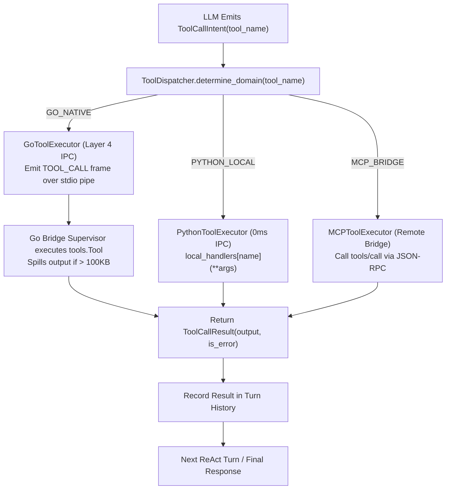

# Tool Development Guide: Co-Located Multi-Tool Architecture

> **Document Version:** 3.0.0 (Polyglot ToolDispatcher & Explicit Tool Registration Standard)  
> **Status:** Authoritative Standard Specification  
> **Target Scope:** Co-Located Multi-Tool Architecture, Explicit Tool Declaration ("A tool exists to be used" — No magic auto-discovery), Polyglot `ToolDispatcher` Routing (Python Local, Go Native IPC, MCP Bridge), Schema Catalog, and Testing  
> **Primary Components:** [`src/agents/Base/base.py`](file:///home/prit/Project_Linux/AI-Personal-Assistant-Backend/src/agents/Base/base.py), [`src/agents/engine/dispatcher/`](file:///home/prit/Project_Linux/AI-Personal-Assistant-Backend/src/agents/engine/dispatcher/), [`src/agents/<worker>/AgentTools/`](file:///home/prit/Project_Linux/AI-Personal-Assistant-Backend/src/agents/research/AgentTools/)

---

## 1. Architectural Philosophy

### A. The Worker-Scoped Principle
Tools must **not** be scattered in arbitrary global directories. Every tool exists directly with its related specialist worker inside `src/agents/<worker_name>/AgentTools/`.

### B. Consolidated File Pattern (No File Explosion)
Rather than creating individual files for each tool (`read.go`, `write.go`, `calc.py`, `nlp.py`), tools for a worker are bundled into **consolidated language files**:
* **`AgentTools/tools.py`**: All in-process Python tool implementations, tool schemas, and registration hooks.
* **`AgentTools/tools.go`**: All Go-native tool implementations and the exported slice factory.

```
src/agents/<worker>/
├── agent.py               # Worker class that explicitly binds tools and coordinates ToolDispatcher
├── prompt.md              # Base system persona and role instructions
├── <worker>_config.json   # Declarative manifest (model config, capabilities, metadata)
└── AgentTools/            # Complete encapsulation of worker tools
    ├── __init__.py        # Re-exports tools, definitions, and handler getters
    ├── tools.py           # Multiple Python tools + unified schema catalog
    └── tools.go           # Multiple Go tools + GetAllTools() slice exporter
```

### C. The Core Axiom: A Tool Exists to be Used
> [!IMPORTANT]
> **Tool auto-discovery has been permanently removed.** Tools are no longer loaded via reflection scanning. A worker agent only knows about tools that are explicitly declared in its tool list (`tools = [...]`) and bound to its [`ToolDispatcher`](file:///home/prit/Project_Linux/AI-Personal-Assistant-Backend/src/agents/engine/dispatcher/dispatcher.py).

---

## 2. Choosing the Execution Domain for a Tool

`ToolDispatcher` routes tool execution across three distinct domains:

| Requirement | **Python Local** (`tools.py`) | **Go Native** (`tools.go`) | **MCP Bridge** (Remote Server) |
| :--- | :--- | :--- | :--- |
| **Execution Domain** | `execution_domain="python_local"` | `execution_domain="go_native"` | `execution_domain="mcp_bridge"` |
| **Execution Path** | In-process asynchronous callable inside Python daemon | Dispatched over Layer 4 IPC pipe to Go tool engine | Standard JSON-RPC protocol over stdio or SSE |
| **Latency** | **0 ms** IPC overhead (direct Python memory/async) | Sub-millisecond OS exec with goroutine concurrency | Remote process / HTTP network latency |
| **Ideal For** | Data parsing, NLP, citation formatting, math, memory | Shell execution, heavy filesystem I/O, Git, Linux signals | External SaaS integrations, Slack, GitHub, MCP servers |

---

## 3. Writing Python Tools in `AgentTools/tools.py`

In `AgentTools/tools.py`, multiple tools are defined using the registration decorator.

### Step 1: Tool Registry Setup
```python
from typing import Any, Callable, Dict, List, Optional, Tuple
from src.agents.contracts import ToolDefinition

REGISTRY: Dict[str, Tuple[ToolDefinition, Optional[Callable]]] = {}

def register_tool(
    name: str,
    category: str,
    description: str,
    risk: str = "LOW",
    prompt_usage_tip: str = "",
    parameters: Optional[Dict[str, Any]] = None,
    execution_domain: str = "python_local",
    required_capability: str = "",
) -> Callable[[Optional[Callable]], Optional[Callable]]:
    def decorator(fn: Optional[Callable] = None) -> Optional[Callable]:
        tool_def = ToolDefinition(
            name=name,
            category=category,
            description=description,
            risk=risk,
            prompt_usage_tip=prompt_usage_tip,
            parameters=parameters or {"type": "object", "properties": {}},
            execution_domain=execution_domain,
            required_capability=required_capability,
        )
        REGISTRY[name] = (tool_def, fn)
        return fn
    return decorator
```

### Step 2: Implement Python-Local Tools
Attach the decorator directly to Python functions. Functions can be either synchronous or `async`:

```python
# --- Python Tool 1: Safe Expression Calculator ---
@register_tool(
    name="research_calculate",
    category="research",
    description="Performs safe mathematical calculations for research data.",
    risk="LOW",
    prompt_usage_tip="Use for quick arithmetic, percentage deltas, or scientific calculation.",
    parameters={
        "type": "object",
        "properties": {
            "expression": {"type": "string", "description": "Mathematical formula to evaluate"}
        },
        "required": ["expression"]
    },
    execution_domain="python_local"
)
def research_calculate(expression: str) -> str:
    # Safe in-process execution logic
    return str(eval(expression, {"__builtins__": {}}, {}))


# --- Python Tool 2: Keyword Extractor ---
@register_tool(
    name="research_extract_keywords",
    category="research",
    description="Extracts key technical terms from text.",
    risk="LOW",
    prompt_usage_tip="Use to summarize articles into key searchable topics.",
    parameters={
        "type": "object",
        "properties": {
            "text": {"type": "string", "description": "Text body to analyze"},
            "top_k": {"type": "integer", "description": "Number of keywords", "default": 5}
        },
        "required": ["text"]
    },
    execution_domain="python_local"
)
def research_extract_keywords(text: str, top_k: int = 5) -> str:
    words = [w for w in text.split() if len(w) > 4]
    return ", ".join(words[:top_k])
```

### Step 3: Declare Go-Native Contracts in the Same File
To ensure the Python agent knows about Go-native tools (so it can expose them to the LLM), declare their schema with `execution_domain="go_native"` and without a Python function body:

```python
# --- Go-Native Tool Contract: Web Search ---
register_tool(
    name="net_search",
    category="net",
    description="Queries web search engines to retrieve relevant snippets and URLs.",
    risk="LOW",
    prompt_usage_tip="Use to find live documentation, news, facts, and external references.",
    parameters={
        "type": "object",
        "properties": {
            "query": {"type": "string", "description": "Search query"},
            "limit": {"type": "integer", "description": "Max results", "default": 10}
        },
        "required": ["query"]
    },
    execution_domain="go_native"
)()
```

### Step 4: Expose Explicit Getters for Agent Instantiation
At the bottom of `AgentTools/tools.py`, expose helpers that the agent passes into `super().__init__(tools=..., local_handlers=...)`:

```python
def get_worker_tools() -> Dict[str, Tuple[ToolDefinition, Optional[Callable]]]:
    return dict(REGISTRY)

def get_tool_definitions() -> List[ToolDefinition]:
    return [t_def for t_def, _ in REGISTRY.values()]

def get_local_handlers() -> Dict[str, Callable]:
    return {name: fn for name, (_, fn) in REGISTRY.items() if fn is not None}
```

---

## 4. Writing Go Tools in `AgentTools/tools.go`

In `AgentTools/tools.go`, implement all Go tools for this worker under a dedicated package (e.g. `package researchtools`).

### Step 1: Implement Tool Structs
Each tool implements the canonical `tools.Tool` interface:
```go
package researchtools

import (
	"context"
	"encoding/json"
	"assistant/src/tools"
)

// --- Tool 1: NetSearchTool ---
type NetSearchTool struct{}

func NewNetSearchTool() *NetSearchTool {
	return &NetSearchTool{}
}

func (t *NetSearchTool) Metadata() tools.ToolMetadata {
	return tools.ToolMetadata{
		Name:            "net_search",
		Category:        "net",
		Description:     "Queries web search engines to retrieve snippets and URLs.",
		ParameterSchema: `{"type":"object","properties":{"query":{"type":"string"}},"required":["query"]}`,
		PromptUsageTip:  "Use net_search to find live documentation and news.",
		Risk:            tools.RiskLow,
	}
}

func (t *NetSearchTool) Execute(ctx context.Context, argsJSON string) (*tools.ToolResult, error) {
	var args struct { Query string `json:"query"` }
	if err := json.Unmarshal([]byte(argsJSON), &args); err != nil {
		return &tools.ToolResult{IsError: true, ExitCode: 1, Stderr: err.Error()}, nil
	}
	return &tools.ToolResult{Stdout: "results..."}, nil
}
```

### Step 2: Export Consolidated Slice Factory
Export a single `GetAllTools()` function that returns all Go tools defined in the file:
```go
// GetAllTools returns all Go-native tools associated with this worker.
func GetAllTools() []tools.Tool {
	return []tools.Tool{
		NewNetSearchTool(),
	}
}
```

### Step 3: Register in Go Dispatcher
In [`src/tools/dispatcher/dispatcher.go`](file:///home/prit/Project_Linux/AI-Personal-Assistant-Backend/src/tools/dispatcher/dispatcher.go):
```go
import (
    researchtools "assistant/src/agents/research/AgentTools"
)

// Inside RegisterAllTools:
allTools = append(allTools, researchtools.GetAllTools()...)
```

---

## 5. Explicit Tool Binding in Agent Creation

In `src/agents/<worker>/agent.py`, inherit from `BaseAgent` and explicitly provide tools and handlers:

```python
from __future__ import annotations
from typing import Callable, Dict, List, Optional

from src.agents.Base import BaseAgent
from src.agents.contracts import AgentContext, AgentType, ToolDefinition
from src.agents.engine.dispatcher import ToolDispatcher
from src.agents.research.AgentTools import (
    enrich_prompt_with_tools,
    get_local_handlers,
    get_tool_definitions,
)
from src.models.base import BaseLLMClient

class ResearchAgent(BaseAgent):
    def __init__(
        self,
        model_client: BaseLLMClient,
        custom_tools: Optional[List[ToolDefinition]] = None,
        custom_handlers: Optional[Dict[str, Callable]] = None,
        tool_dispatcher: Optional[ToolDispatcher] = None,
    ) -> None:
        # 1. Explicit tool list (No auto-discovery: "A tool exists to be used")
        tools = custom_tools if custom_tools is not None else get_tool_definitions()

        # 2. Explicit local Python handlers
        self.local_handlers: Dict[str, Callable] = dict(get_local_handlers())
        if custom_handlers:
            self.local_handlers.update(custom_handlers)

        # 3. BaseAgent wires ToolDispatcher and ToolRegistry automatically
        super().__init__(
            model_client=model_client,
            agent_type=AgentType.RESEARCH,
            tools=tools,
            local_handlers=self.local_handlers,
            tool_dispatcher=tool_dispatcher,
        )

    def get_enriched_prompt(self) -> str:
        """Dynamically enriches base prompt with active tool guidance."""
        return enrich_prompt_with_tools(self.get_system_prompt(), self.get_tools())
```

---

## 6. How the ReAct Turn Execution Loop Handles Polyglot Tools

During an autonomous turn, `ReActEngine` delegates execution to `ToolDispatcher`:



---

## 7. Developer Checklist for Adding a New Tool

1. **Decide Execution Domain**:
   - `python_local`: Fast in-memory data processing, NLP, arithmetic, or local RAG.
   - `go_native`: Native OS commands, process management, high-throughput filesystem I/O, Git, or network.
   - `mcp_bridge`: Remote MCP servers or third-party cloud integrations.
2. **If Python**:
   - Open `src/agents/<worker>/AgentTools/tools.py`.
   - Add `@register_tool(..., execution_domain="python_local")` decorated callable.
3. **If Go**:
   - Open `src/agents/<worker>/AgentTools/tools.go`.
   - Implement your struct satisfying `tools.Tool` (`Metadata()` + `Execute()`).
   - Add your tool struct to `GetAllTools()`.
   - In `src/agents/<worker>/AgentTools/tools.py`, add the `register_tool(..., execution_domain="go_native")()` schema so Python advertises it to the LLM.
4. **Explicit Binding**:
   - Ensure the worker's `agent.py` explicitly receives and passes `tools` and `local_handlers` to `BaseAgent` / `ToolDispatcher`.
5. **Test**:
   - Write pytest unit tests in `test/agents/test_<worker>_agent_tools.py`.
   - Test direct tool execution: `await agent.execute_tool("<name>", {...})`.
   - Run `go build ./src/agents/<worker>/AgentTools/...` to ensure Go compilation succeeds.
   - Run `./.venv/bin/pytest test/agents/` to ensure zero regressions.
